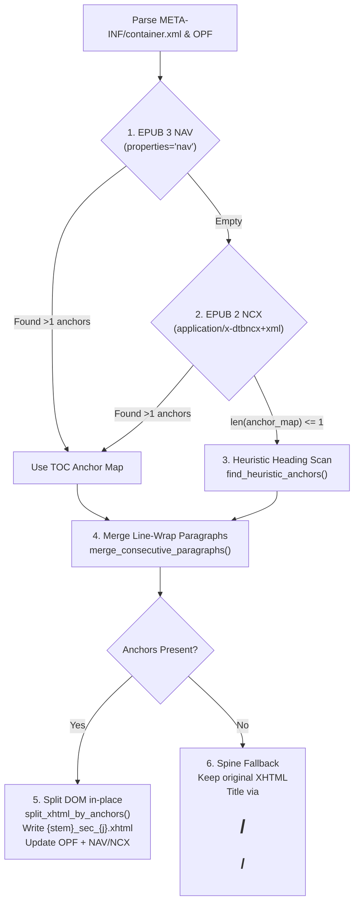

# Epuboverlay Architectural & Development Blueprint

This skill codifies the verified architecture, preprocessing internals, TTS engine contracts, web/pipeline lifecycle, and security guardrails for `epuboverlay`.

---

## 1. Document Preprocessing Architecture (`epuboverlay/preprocessors/`)

Handling user-generated documents (from Calibre, InDesign, Pages, Word, or web scrapers) requires normalizing wildly different structures into a uniform model.

### A. File-Type Strategy Pattern (`base.py`, `__init__.py`)
All format preprocessors inherit from `BasePreprocessor` (`can_handle(file_path) -> bool`, `extract_sections(file_path) -> list[DocumentSection]`) and are dispatched via `get_preprocessor(file_path)`:
- **`DocumentSection` Dataclass**:
  - `id: str` — section/chapter identifier (e.g., `"ch1_sec_0"`, `"page_1"`, `"docx_sec_0"`, `"section_0"`).
  - `title: str` — human-readable section title.
  - `text_content: str` — plain text for character counting and preview.
  - `char_count: int` — character length of `text_content`.
  - `preview: str` — first 1,000 characters for UI preview cards.
- **Current Format Support Status**:
  - `EPUBPreprocessor` (`epub.py`): Full support in both chapter preview (`POST /api/chapters`) and in-place workspace mutation (`preprocess_epub_workspace()` in `pipeline.py`).
  - `PDFPreprocessor` (`pdf.py`), `DOCXPreprocessor` (`docx.py`), `MarkdownPreprocessor` (`markdown.py`), `TXTPreprocessor` (`txt.py`): Used by `POST /api/chapters` for section preview, and automatically wrapped into a valid EPUB 3 container (`build_epub_from_sections()` / `ensure_epub_file()` in `preprocessors/base.py` & `__init__.py`, marked with `<meta property="epuboverlay:preprocessed">true</meta>`) during `JobManager.create_job()` and `generate_media_overlay_epub()`.

### B. EPUB Layout & TOC Discovery Chain (`preprocessors/epub.py`)
EPUB preprocessing operates in two places: read-only preview (`EPUBPreprocessor.extract_sections`) and in-place workspace mutation (`preprocess_epub_workspace(workspace_dir)` called during Phase 1 of `generate_media_overlay_epub`).



#### Critical Ordering & Implementation Invariants
1. **Heuristics BEFORE Paragraph Merging (`epub.py#L610-L621`, `#L843-L853`)**:
   - Always run `find_heuristic_anchors(xhtml_root)` **before** `merge_consecutive_paragraphs(xhtml_root)`.
   - `merge_consecutive_paragraphs()` joins consecutive `<p>` tags with matching CSS classes when the first `<p>` lacks terminal punctuation (`.?!:;"'”’`), skipping `<br>` and empty `<p>` spacers. Running it first would merge unpunctuated headings (e.g., `<p>PART TWO</p>`) into the following paragraph and break `HEADING_KEYWORDS_RE`.
2. **Heuristic Heading Rules (`find_heuristic_anchors`)**:
   - Normalizes whitespace and collapses spaced single letters (`"P A R T"` -> `"PART"`, `"O N E"` -> `"ONE"`).
   - Matches `HEADING_KEYWORDS_RE` (`PART|CHAPTER|PRINCIPLE|BOOK|SECTION` + numerals/ordinals, or standalone `PREFACE|INTRODUCTION|FOREWORD|NOTES|EPILOGUE|...`) with length 3–120 chars and a minimum 500-character distance between consecutive candidates to ignore inline TOC lists.
   - Injects `id="dyn_heading_{n}"` onto matched `<p>` elements lacking an `id`.
3. **DOM Splitting & TOC Regeneration (`split_xhtml_by_anchors`, `update_nav_ncx`)**:
   - Splits multi-section XHTML files into `{stem}_sec_{j}.xhtml` with manifest/spine ID `{idref}_sec_{j}`.
   - Rewrites relative links in NAV/NCX via `update_nav_ncx()`, or regenerates NAV/NCX from scratch (`regenerate_nav_file`, `regenerate_ncx_file`) when heuristics were used.
4. **Target Evolution**:
   - Future refactoring of `epub.py` should encapsulate the procedural steps above into composable strategy classes as outlined in [Development Strategy](./references/Development%20Strategy.md), while deduplicating the 3x repeated NAV/NCX parsing across `pipeline.py:parse_epub_toc`, `epub.py:parse_epub_toc_filesystem`, and `EPUBPreprocessor.extract_sections`.

---

## 2. TTS Synthesizer Contracts (`epuboverlay/synthesizers/`)

All synthesizers register in `epuboverlay/synthesizers/__init__.py` (`_REGISTRY` / `create_synthesizer(synth_id, **kwargs)`) and inherit from `BaseSynthesizer` (`base.py`):

1. **Strictly Lazy Top-Level Imports**:
   - `epuboverlay/__init__.py` and `epuboverlay/synthesizers/__init__.py` eagerly import all synthesizer *classes* (`DummySynthesizer`, `KokoroSynthesizer`, `PocketSynthesizer`, `F5TTSSynthesizer`) and voice lists (`KOKORO_VOICES`, `POCKET_VOICES`).
   - Therefore, **never** import `torch`, `torchaudio`, `scipy`, `kokoro`, `pocket_tts`, or `f5_tts` at module top level. Import them inside `__init__()` or method bodies with an `ImportError` message pointing to `uv add "epuboverlay[<extra>]"`.
2. **Interface Contract (`BaseSynthesizer` / `FrameTimedSynthesizer`)**:
   - `synthesize(self, text: str) -> tuple[bytes, int]`: Must return `(wav_bytes, num_frames)` where `wav_bytes` is a complete mono 16-bit PCM WAV header+payload and `num_frames >= 0`.
   - `sample_rate -> int` (default `24000` Hz) and `speed -> float` properties.
   - **Thread Safety**: Because `pipeline.py` uses `ThreadPoolExecutor(max_workers=concurrency)` to synthesize chunks concurrently, stateful GPU/CPU pipelines that are not thread-safe must serialize inference with a lock (see `KokoroSynthesizer._lock` in `kokoro.py#L92`).
3. **Engine Capabilities & Hardware Profiles**:
   - `dummy`: Pure stdlib (`wave`, `io`) silent WAV generator (`15.0 * speed` chars/sec) for zero-dependency testing.
   - `pocket-tts` (`pocket.py`): Kyutai Labs ~100M parameter CPU model (`POCKET_VOICES` presets or zero-shot `ref_audio` cloning). Supports 7 native language checkpoints (`POCKET_LANGUAGES`: `english`, `english_2026-04`, `german_24l`, `spanish_24l`, `french_24l`, `italian_24l`, `portuguese_24l`), granular acoustic tuning (`temp`, `lsd_decode_steps`, `noise_clamp`, `eos_threshold`, `frames_after_eos`, `quantize`), thread-safety via `self._lock`, and multi-speaker quoted-dialogue state switching (`dialogue_voice` and inline `[voice:name]` / `[emotion:name]` tags).
   - `kokoro` (`kokoro.py`): Kokoro-82M (`hexgrad/Kokoro-82M`), supports 54 built-in voices (`KOKORO_VOICES`), 9 language codes (`a,b,e,f,h,i,j,p,z`), and weighted voice blending formulas (`"af_heart*0.6+af_sky*0.4"` via `_parse_voice_formula`). Ultra-fast RTF (0.03–0.05 on GPU, ~0.15 on CPU; ~20–30 mins for a 10-hour book).
   - `qwen3-tts` (`qwen3.py`): Alibaba Qwen3-TTS (`Qwen/Qwen3-TTS-12Hz-1.7B-CustomVoice`, `1.7B-VoiceDesign`, `1.7B-Base`, `0.6B-Base`). Supports 10 languages (**EN, RU, KO, JA, ZH, DE, ES**, FR, IT, PT; `QWEN3_LANGUAGES` uses ISO keys mapped via `normalize_qwen_language()` to full names required by `Qwen3TTSModel._validate_languages()`), 9 built-in `CustomVoice` preset speakers (`QWEN3_VOICES`: `Ryan`, `Aiden`, `Serena`, `Vivian`, `Uncle_Fu`, `Dylan`, `Eric`, `Ono_Anna`, `Sohee`; default `"Ryan"`), free-form natural-language emotion & intonation prompts (`instruct` + inline `[instruct: ...]` overrides), text-to-voice persona design (`voice_design`), and 3-second zero-shot cloning (`clone`, precomputing `self._voice_clone_prompt` via `create_voice_clone_prompt(..., x_vector_only_mode=not bool(self.ref_text))`). Auto-aligns `model_name` checkpoint when `mode` is switched. Uses `_MODEL_CACHE` to reuse loaded GPU weights across different reference voices without reloading safetensors or exhausting VRAM. The `0.6B-Base` model runs ~3x faster than `1.7B` (~2h vs ~7h for a 10-hour book).
   - `cosyvoice2` (`cosyvoice.py`): FunAudioLLM `CosyVoice2-0.5B` (`iic/CosyVoice2-0.5B`). Supports 9 languages (**EN, RU, KO, JA, ZH, DE, ES**, FR, IT) via language tokens (`<|en|>`, `<|ru|>`, `<|ko|>`, `<|jp|>`, `<|zh|>`, `<|de|>`, `<|es|>`, `<|fr|>`, `<|it|>`), 3 cloning modes (`instruct` via `inference_instruct2`, `zero_shot`, `cross_lingual`), preset SFT speaker mode (`sft` with `COSYVOICE_VOICES`: `英文女`, `英文男`, `中文女`, `中文男`, `日语男`, `韩语女`, `粤语女`), and inline paralinguistic tags (`[breath]`, `[sigh]`, `[laughter]`, `<strong>emphasis</strong>`). Uses `_ensure_cosyvoice_on_path()` to dynamically locate `third_party/CosyVoice` (with `Matcha-TTS`) or `~/.epuboverlay/cosyvoice`, and `_COSY_MODEL_CACHE` for persistent model weight reuse in VRAM.
   - `fish-speech` (`fish.py`): FishAudio `Fish-Speech-1.5` / `OpenAudio-S1-Mini`. Supports all **8 core target languages** (**EN, RU, KO, JA, ZH, DE, ES, and AR Arabic**), 44.1 kHz CD-quality audio, inline emotion/tone markers (`(excited)`, `(sad)`, `(angry)`, `(whispering)`, `(soft tone)`, `(empathetic)`, `(serious)`, `(in a hurry tone)`), and dual execution via local GPU engine or high-concurrency cloud API (`fish_audio_sdk` / `FISH_API_KEY`), which offloads all compute (0 MB local VRAM).
   - `f5-tts` (`f5tts.py`): ~300M parameter flow-matching voice cloner; requires both `ref_audio` and `ref_text`, caches preprocessed reference audio/mel tensors across chunks, uses `self._lock` for thread safety, and supports `nfe_step` (10–64, default 32; dropping to 16 doubles speed) and `torch.compile`.
   - **Inference Optimization Standards**: All neural synthesizers execute forward passes under `with torch.inference_mode():` inside their instance lock (`self._lock`), enable TF32 on CUDA (`torch.backends.cuda.matmul.allow_tf32 = True`, `cudnn.allow_tf32 = True`, `cudnn.benchmark = True`), and load in half-precision (`bfloat16`/`float16`) where supported.
   - See [Lightweight TTS Models: Advanced Options](./references/Lightweight%20TTS%20Models:%20Advanced%20Options.md) for benchmarks.

---

## 3. Pipeline, Caching & Audio Export (`pipeline.py`, `extract.py`, `normalization.py`)

### A. 5-Phase Overlay Generation (`generate_media_overlay_epub`)
1. **Workspace & Cache Resolution**:
   - Cache directory: `~/.epuboverlay/cache/{epub_md5}_{config_md5}/` (`_compute_config_hash` hashes synthesizer class, voice/formula/ref_audio mtime+size, speed, nfe_step, frame_rate, max_chars, and `normalization_settings`).
   - **Self-Healing Split Cache (`pipeline.py#L1450-L1460`)**: If `selected_chapters` contains split IDs (`_sec_`) but the cached OPF spine does not, `.extracted` is invalidated and `_prepare_workspace()` re-runs `preprocess_epub_workspace()`.
2. **Sentence Splitting & Span Injection (`process_element`)**:
   - Wraps sentences/chunks (capped at `max_chars`, default 150) in `<span id="epuboverlay-s-{n}">` inside the XHTML DOM.
   - `split_into_sentences()` and `split_recursive()` are multilingual-aware, supporting Latin, Cyrillic (`А-ЯЁ`), Hangul (`가-힣`), CJK (`。！？`), and Arabic (`؟،؛`) sentence boundaries.
3. **Pre-Pass, Narration Scenarios & Multilingual Normalization (`_synthesize_chapter_chunks`, `normalization.py`)**:
   - `NARRATION_SCENARIOS` (`custom`, `fiction_audiobook`, `technical_docs`, `executive_briefing`, `language_learning`, `dramatic_dialogue`) in `normalization.py` defines scenario presets for `speed`, `max_chars`, `temp`, `lsd_decode_steps`, `noise_clamp`, `eos_threshold`, `frames_after_eos`, `instruct`, and `emotion_tag`.
   - Before synthesis, `normalize_text(text, normalization_settings, language=...)` uses `detect_text_language(text, hint)` (Unicode script + ISO hint detection) so English-only rules (`resolve_contractions`, `resolve_heteronyms`, and `fallback_num2words`) only run when `lang == "en"`, while `num2words(num, lang=lang)` expands numerals in Russian, Korean, Japanese, Chinese, German, Spanish, and Arabic without corrupting non-English text.
   - Each chunk is cached on disk as `_chunks_{idref}/chunk_{idx:06d}_{text_hash}.wav`. Valid existing WAV chunks and completed chapter `.m4a` + `.smil` pairs are automatically reused on resume (unless `EPUB_BYPASS_CACHE=1`).
4. **Audio Encoding & SMIL Registration**:
   - Chunk WAVs are concatenated via `stream_concat_wav_to_file()` and converted to AAC `.m4a` (`64k`, `media-type="audio/mp4"`) using external `ffmpeg` (`convert_wav_file_to_m4a`).
   - Generates `<smil>` with `<par><text src="..."/><audio src="..." clipBegin="...s" clipEnd="...s"/></par>` and updates OPF `<item>` and `media:duration` metadata.
5. **Memory & Thread Discipline**:
   - Both CLI (`cli.py#L15-L25`) and Web worker processes (`jobs.py#L350-L360`) pin `OMP_NUM_THREADS=1`, `MKL_NUM_THREADS=1`, `OPENBLAS_NUM_THREADS=1`, and `torch.set_num_threads(1)` to avoid CPU thread oversubscription when `concurrency > 1`.
   - At the end of every chapter (`pipeline.py#L1644-L1658`), references are cleared, `gc.collect()`, `torch.cuda.empty_cache()`, and `libc.malloc_trim(0)` are called to prevent RAM/VRAM creep on long books.

### B. Audiobook & Subtitle Extraction (`extract.py`)
- `epub_to_audio_subtitles()` parses SMIL + XHTML overlays (`parse_epub_overlays`) and exports per-chapter or merged `.m4b` (with FFmetadata chapter markers and 1400x1400 cover art) or `.m4a`, optional static black `.mp4` video (with optional burned-in subtitles), and subtitle files in `ass`, `srt`, `vtt`, `ttml`, `sbv`, `lrc`, and `txt`.
- Requires `ffmpeg` and `ffprobe` on `PATH`.

---

## 4. Web Dashboard & Dependency Tiers (`epuboverlay/web/`, `pyproject.toml`)

- **Process Model (`jobs.py`)**: `JobManager` runs one synthesis job at a time in an isolated `multiprocessing.get_context("spawn")` child process (`run_job_process`), streaming progress events over an IPC `Queue` to SSE subscribers (`GET /api/jobs/{job_id}/events`). Also detects running CLI jobs via `~/.epuboverlay/cache/*/progress.json`.
- **Persistent User Data (`~/.epuboverlay/`)**:
  - `jobs/{job_id}/job.json`, `input.epub`, `output_*.epub`, `audio/{idref}.m4a`
  - `references/metadata.json` & reference audio clips
  - `settings.json` & `voice_blends.json`
- **Installation Tiers (`pyproject.toml`, `requires-python = ">=3.11,<3.14"`)**:
  - Inside the repository workspace, install extras with `uv sync --extra <name>` (or `uv sync --extra all`), not `uv add "epuboverlay[<name>]"`.
  - **Minimal (Default)**: `fastapi`, `uvicorn`, `psutil`, `python-multipart` (`uv run epuboverlay-web`).
  - **Standard (`--extra standard`)**: Adds `kokoro`, `pocket-tts`, `scipy`, `pypdf`, `python-docx`.
  - **Multilingual & Emotional Engines (`--extra qwen`, `--extra cosyvoice`, `--extra fish`, or `--extra multilingual`)**: Adds `qwen-tts` (`Qwen3-TTS`), `modelscope` (`CosyVoice2-0.5B`), and `fish-audio-sdk` + `ormsgpack` (`Fish-Speech-1.5` / `OpenAudio-S1-Mini`).
  - **Full (`--extra full` / `all`)**: Adds `f5-tts` + all multilingual neural engines (PyTorch + CUDA stack).
  - `server.py:get_installed_synthesizers()` verifies engines via `importlib.util.find_spec()` (`qwen_tts`, `fish_speech`/`fish_audio_sdk`, `f5_tts`), `_ensure_cosyvoice_on_path()`, or environment variables (`COSYVOICE_API_URL`, `FISH_SPEECH_API_URL`).
  - **Playground LRU Cache & VRAM Safety**: `_PREVIEW_SYNTH_CACHE` uses `_MAX_CACHE_SIZE = 1` with strict pre-eviction, `gc.collect()`, and `torch.cuda.empty_cache()` *before* instantiating a new synthesizer. If an OOM occurs, `clear_qwen_model_cache()`, `clear_cosy_model_cache()`, and `_PREVIEW_SYNTH_CACHE.clear()` automatically flush GPU memory.
- **Frontend Voice Modes & Cache-Busting (`epuboverlay/web/static/`)**:
  - All engines supporting preset and cloning modes (`pocket-tts`, `qwen3-tts`, `cosyvoice2`, `fish-speech`) expose `.voice-mode-selector` pills on both the **Generate Overlays** page (`index.html` + `app.js`) and the **Voice Playground** (`index.html` + `playground.js`).
  - Both pages provide a **`⚡ Compute Device`** selector (`Auto (Best Available / GPU)`, `CUDA (NVIDIA GPU)`, `CPU`, `MPS (Apple Silicon)`).
  - Selecting Clone mode on Generate reveals `#cloning-options` (Saved Reference Voice select + Reference Audio upload + Reference Text transcript `#ref-text-input`); selecting Clone mode in the Playground reveals `#pg-f5-panel` (Saved Reference Voice select + Upload Custom File + Microphone Audio Recorder + Reference Text transcript).
  - `verify_same_origin()` middleware in `server.py` sets `Cache-Control: no-cache, must-revalidate` on `/` and `/static/*` responses, and ES module imports in `static/js/*.js` carry versioned query strings (`?v=6`) to prevent browsers from serving stale cached modules.

---

## 5. Security, UX & Testing Guardrails

1. **Filesystem, ZIP & Request Safety**:
   - Always sanitize uploaded filenames with `Path(upload.filename).name` and stream uploads via `_save_upload_to_temp()` / `_read_upload_bytes()` in `server.py` (enforcing `MAX_UPLOAD_BYTES`).
   - Extract archives exclusively via `safe_extract_zip()` and validate OPF/manifest paths via `resolve_safe_path()` (`preprocessors/base.py`) so resolved paths stay strictly inside the workspace (`resolved.is_relative_to(workspace_dir)`).
   - Always clean up temporary files and directories created with `tempfile.NamedTemporaryFile(delete=False)` or `tempfile.mkdtemp()` (use `BackgroundTask(shutil.rmtree, ...)` on `FileResponse`).
   - Mutating `/api/*` endpoints are protected against cross-origin CSRF by `verify_same_origin()` middleware in `server.py`, and CLI job termination in `JobManager.cancel_job()` verifies active `cli-{pid}` membership via `_scan_cli_jobs()`.
2. **Frontend XSS & Audio Recording Guardrails**:
   - Always pass untrusted strings (book titles, chapter titles, chapter previews, error messages, toast notifications, voice names) through `escapeHtml()` from `static/js/utils.js` or assign via `.textContent` rather than raw `innerHTML`.
   - Use `setupAudioRecorder()` and `convertRecordedBlobToWav()` from `static/js/utils.js` for microphone capture so browser `MediaRecorder` streams are decoded into genuine 16-bit PCM RIFF WAV blobs.
3. **Running Tests**:
   - Run unit tests via:
     ```bash
     uv run python -m unittest discover tests
     ```
   - When adding a new preprocessor or fixing an e-book layout anomaly, add a minimal XHTML/document fixture in `tests/test_preprocessors.py`.
   - Pass an explicit temporary `cache_dir` in pipeline tests so tests do not write to `~/.epuboverlay/cache`.
